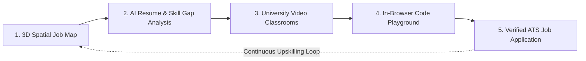

# 🇮🇳 Smart India Hackathon (SIH 2026) — Project Proposal

## 📌 Project Information

- **Project Title:** CareerMap AI: Hyperlocal Spatial Job Discovery & Closed-Loop AI Upskilling Ecosystem
- **Category:** Software Edition
- **Domain / Theme:** Smart Education / Student Employability / Skill Development
- **Sub-theme:** Bridging Industry-Academia Skill Deficits & Democratizing Job Access

---

## 📄 1. Executive Abstract Summary
*(Word Count: ~210 words — optimized for direct copy-paste into the official SIH portal abstract submission field)*

> India’s higher education system produces over 1.5 million engineering graduates annually, yet more than 80% face severe employability hurdles due to disconnected job portals, opaque skill requirements, and fragmented, paywalled learning resources. **CareerMap AI** introduces India's first unified, closed-loop career discovery and upskilling ecosystem designed to systematically eliminate this industry-academia disconnect.
>
> CareerMap AI combines **3D spatial mapping (Mapbox GL)** with real-time job aggregation (Tavily/JSearch) to let candidates discover hyperlocal tech opportunities sorted by physical distance. Coupled with an intelligent **AI Career Co-Pilot (Mistral AI)**, the platform parses PDF resumes, diagnoses exact competency gaps against targeted job descriptions, and dynamically synthesizes personalized, bite-sized learning roadmaps. Unlike conventional job boards that stop at job listings, CareerMap AI embeds **university-grade modular video classrooms** (curated from Harvard CS50, Stanford ML, and MIT curricula) and a **zero-setup, in-browser multi-language code playground** (Python, C++, Java, JavaScript).
>
> By closing the loop between **Discovery $\rightarrow$ Skill Gap Diagnosis $\rightarrow$ Hands-on Learning $\rightarrow$ Code Execution $\rightarrow$ Job Application** within a single responsive interface, CareerMap AI democratizes world-class tech education for Tier-2 and Tier-3 institutions, while advancing the objectives of the National Education Policy (NEP 2020) and the Skill India Mission.

---

## 💡 2. Detailed Idea Description

### 2.1 The Core Problem & Industry Challenge
1. **Opaque & Fragmented Job Discovery:** Mainstream hiring platforms (LinkedIn, Indeed, Naukri) offer text-heavy search experiences devoid of spatial context. Students cannot easily identify tech clusters, SEZs, or local startup hubs relative to their physical location across Indian cities.
2. **The "Silent Rejection" Skill Gap:** Engineering candidates submit dozens of resumes into black-box ATS systems without understanding why their profiles fail screening or which critical industry technologies (e.g., containerization, state management, algorithm patterns) are missing.
3. **Decoupled Learning & Practice:** When candidates discover their missing competencies, they are forced to jump across fragmented platforms—purchasing expensive courses, scouring disparate YouTube tutorials, and wrestling with local IDE installations. This friction leads to high drop-off rates and a lack of verified practical skill.

---

### 2.2 Proposed Innovation: The Closed-Loop Ecosystem
CareerMap AI solves this fragmentation by uniting the entire employment lifecycle into five interconnected pillars:



1. **📍 Hyperlocal 3D Spatial Canvas:**
   - Detects user browser coordinates and calculates exact Haversine distances to active tech job postings across India.
   - Leverages a custom Mapbox GL 3D vector canvas with tech-hub clustering, daylight styling, and interactive corporate markers.

2. **🤖 Mistral AI Career Co-Pilot & Resume Intelligence:**
   - Drag-and-drop PDF resume parser extracting technical skills, education, and project records.
   - Dynamic prompt synthesis cross-references candidate competencies against target job descriptions to calculate an ATS compatibility score and pinpoint missing competencies.
   - Generates daily, bite-sized learning tasks mapped directly to high-yield micro-lessons.

3. **🎓 University-Grade Video Classrooms:**
   - Free, modular curricula sourced from top global institutions (Harvard CS50x, Stanford ML, MIT 6.006, Google Cloud, Meta React, IBM Data Science, Linux, and Git).
   - Chaptered video lessons with synchronized notes, syllabus breakdown, and verifiable certificate issuance upon completion.

4. **💻 Zero-Setup Serverless Code Playground:**
   - Full-featured in-browser code editor with integrated syntax highlighting and tabbed execution console.
   - Multi-language runtime engine supporting Python, JavaScript, C++, and Java with custom stdin/stdout handling.

5. **📊 Real-Time Analytics & Streak Tracking:**
   - Firebase Cloud Firestore synchronization tracking daily learning streaks, module completions, and skill progression metrics.

---

## 🚀 3. Key Innovations & Differentiators (USP)

| Dimension | Traditional Portals (LinkedIn, Indeed, Naukri) | Traditional EdTech (Coursera, Udemy) | **CareerMap AI (Our Solution)** |
|---|---|---|---|
| **Job Search Interface** | Flat, text-based keyword listings | Not available | **Interactive 3D Geospatial Map with distance sorting** |
| **Skill Gap Diagnosis** | Missing or gated behind paid tiers | Static diagnostic quizzes | **Automated AI Resume vs. Job Description cross-audit** |
| **Integrated Upskilling** | External redirects to 3rd-party sites | Isolated, paywalled courses | **Curated open Ivy League / FAANG curriculum embedded** |
| **Hands-on Verification** | None (purely informational) | Often requires heavy local IDE setup | **In-browser, multi-language sandbox with live I/O** |
| **Accessibility & Cost** | Freemium with aggressive paywalls | Expensive certifications ($50-$500) | **100% open, accessible to Tier-2/Tier-3 students** |

---

## 🛠️ 4. Technical Architecture & Tech Stack

```mermaid
graph TD
    subgraph Client Layer [Frontend Client Layer]
        A1[Next.js 16 App Router & React 19]
        A2[Tailwind CSS v4 & Framer Motion]
        A3[Mapbox GL / React Map GL 3D]
    end

    subgraph Service Layer [Serverless Next.js API Routes]
        B1[/api/jobs - Proximity Aggregator]
        B2[/api/parse-resume - PDF Text Extractor]
        B3[/api/ai/generate-tasks - Mistral Engine]
        B4[/api/execute - Multi-Language Code Sandbox]
    end

    subgraph External Engines [AI & Cloud Services]
        C1[Mistral AI API - mistral-small-latest]
        C2[Tavily Search API & JSearch RapidAPI]
        C3[Firebase Auth & Cloud Firestore]
        C4[Vercel Serverless Edge Platform]
    end

    Client Layer --> Service Layer
    Service Layer --> External Engines
```

- **Frontend:** Next.js 16 (App Router), React 19, TypeScript 5, Tailwind CSS v4, Framer Motion, Lucide React.
- **Geospatial Engine:** Mapbox GL & React Map GL with 3D terrain building layers and daylight styling.
- **AI Intelligence:** Mistral AI (`mistral-small-latest`) API for resume analysis and prompt-engineered daily upskilling tasks.
- **Data & Jobs Aggregation:** Tavily Search API & JSearch RapidAPI for live real-time job indices.
- **Sandboxed Execution:** Serverless runtime execution API (`/api/execute`) supporting Python, C++, Java, and JavaScript.
- **Database & Identity:** Firebase Authentication (OAuth & Guest Access) and Cloud Firestore for real-time progress state.

---

## 🇮🇳 5. Social Impact & Alignment with National Priorities

1. **National Education Policy (NEP 2020):** Emphasizes multidisciplinary, experiential, and skill-based learning over rote memorization. CareerMap AI enables self-paced, project-driven competency acquisition.
2. **Skill India & AICTE Employability Missions:** Leveling the playing field for students from rural and Tier-2/Tier-3 engineering colleges who lack on-campus placement drives by connecting them to verified global curricula and nationwide opportunities.
3. **Hyperlocal Economic Growth:** Reduces unnecessary metropolitan migration by spotlighting emerging tech parks, tier-2 tech startups, and remote-first opportunities across Indian state corridors.

---

## 📈 6. Feasibility, Scalability & Future Roadmap

- **Phase 1 (Current / Working Prototype):** Geospatial job discovery, PDF resume parsing, Mistral AI task generator, 8 university courses, multi-language sandbox, and Firebase synchronization.
- **Phase 2 (Hackathon / 3-Month Target):** Integration with Government Job Portals (NCS - National Career Service, AICTE Internship Portal) and vernacular language AI narration for regional learners.
- **Phase 3 (Enterprise & Institutional Rollout):** College placement cell administrative dashboards for batch-level skill gap reporting and automated recruiter interview scheduling.

---

## 📑 7. Recommended SIH Presentation PPT Slide Structure

When preparing the mandatory **SIH PowerPoint Slide Deck** (5–7 slides), use the following structure:

1. **Slide 1: Cover & Team Introduction**
   - Title: *CareerMap AI*
   - Problem Statement ID & Title
   - Team Name, College / Institute Name, Team Leader & Members
2. **Slide 2: The Problem Statement & Industry Reality**
   - 80%+ employability gap in technical education
   - Disconnect between college syllabi and real industry requirements
   - Spatial blindness in existing job boards
3. **Slide 3: Proposed Solution & System Workflow**
   - Closed-loop workflow diagram: Spatial Discovery $\rightarrow$ AI Diagnosis $\rightarrow$ Modular Learning $\rightarrow$ Code Execution $\rightarrow$ Direct Apply
4. **Slide 4: Technical Architecture & Core Innovations (USP)**
   - Tech stack diagram (Next.js 16, Mapbox GL 3D, Mistral AI, Firebase)
   - Comparison matrix showing differentiation from LinkedIn/Coursera
5. **Slide 5: Live Product Demonstration**
   - High-resolution screenshots of 3D Map, Resume Analysis Modal, Code Playground, and Course Classroom
6. **Slide 6: Social Impact, NEP 2020 Alignment & Future Scope**
   - Impact metrics for Tier-2/3 students, NCS integration roadmap, scalability plan
